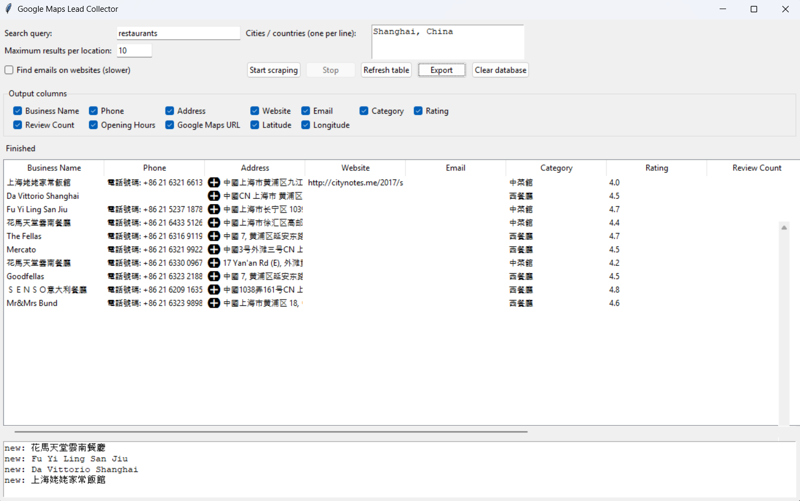
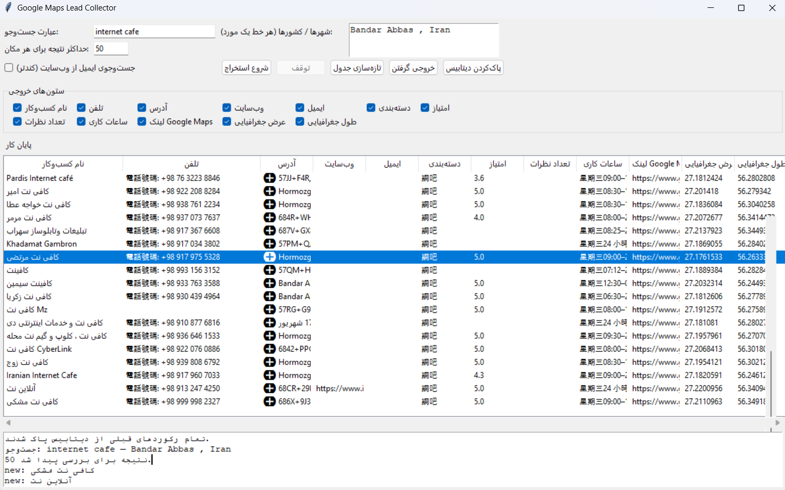
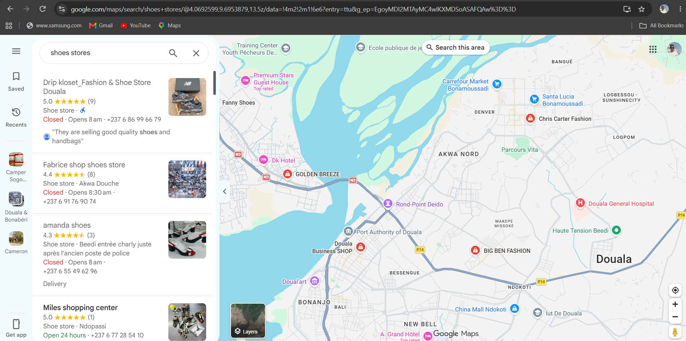
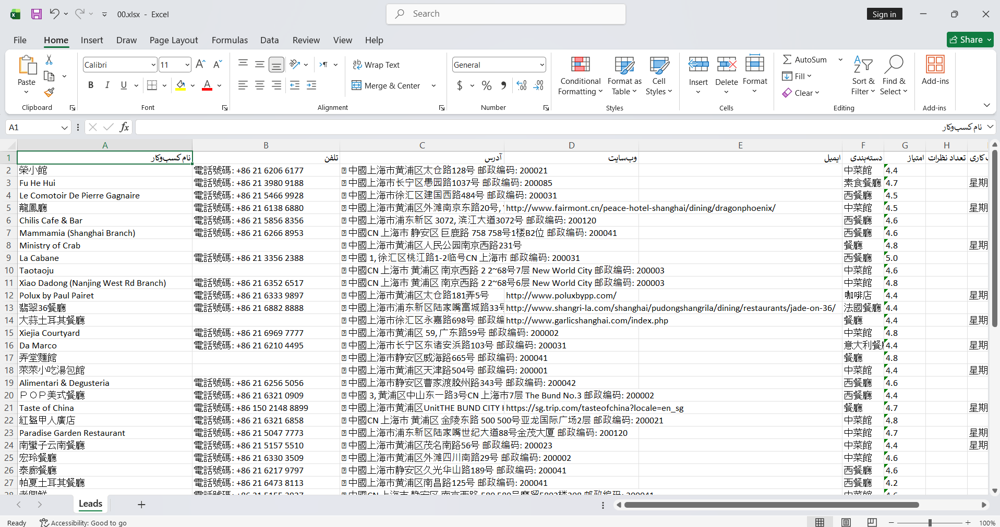

# 📍 Google Maps Lead Collector

> **A free Python desktop application for collecting and organizing business leads from Google Maps.**

Google Maps Lead Collector helps freelancers, sales professionals, marketing agencies, and business owners find local businesses and organize their information for lead generation, sales prospecting, and market research.

---

### 🌟 Key Highlights
* 🖥️ **Desktop GUI**
* 🌐 **English and Persian versions**
* 🔎 **Automated Google Maps browsing with Playwright**
* 📊 **Multiple export formats**
* 🗄️ **SQLite database for persistent storage**
* 🔄 **Live results as businesses are collected**

---

## 🚀 What Is This Tool?

Finding potential customers manually can take a lot of time. Google Maps Lead Collector automates parts of the business research process by browsing Google Maps, collecting available business information, and organizing the results in a desktop application.

You can search for businesses by keyword and location, monitor collected results, avoid duplicate entries, and export your data for further use.

---
## 🎯 Use Cases

* **Lead Generation:** Build lists of potential customers.
* **Sales Prospecting:** Find businesses to contact about products or services.
* **Web Design Agencies:** Research local businesses that may need website services.
* **Digital Marketing:** Identify businesses for marketing and SEO campaigns.
* **Market Research:** Explore businesses in a specific location or industry.
* **Business Directories:** Collect and organize local business information.
* **Freelancing:** Research potential clients in your target market.

---

## ✨ Features

* **Graphical User Interface:** Use the application without working directly in the command line.
* **English and Persian Interfaces:** Choose the version that suits you.
* **Automated Browsing:** Uses Playwright to interact with Google Maps.
* **Live Results:** View businesses as they are collected.
* **Business Information Extraction:** Collect available business names, phone numbers, and addresses.
* **Duplicate Prevention:** Normalize Google Maps links to help prevent duplicate records.
* **Incomplete Data Handling:** Attempt to complete missing information when available.
* **SQLite Storage:** Preserve collected data in a local database.
* **Search History Management:** Clear search history when needed.
* **Results Management:** Clear displayed results independently.
* **Database Reset:** Reset stored records when necessary.
* **Data Export:** Export collected information into supported file formats.

> ⚠️ **Note:** The information collected depends on what Google Maps makes available and how its pages behave. Not every business will have complete contact information.
---

## 📁 Supported Export Formats

| Format | File extension | Typical use |
| :--- | :--- | :--- |
| **CSV** | `.csv` | Spreadsheets and data processing |
| **Excel** | `.xlsx` | Reviewing and organizing leads |
| **JSON** | `.json` | Developers and data integration |
| **Text** | `.txt` | Simple text-based records |
| **SQLite** | `.sqlite3` | Local database storage |

> Export options may vary by application version. SQLite is used for persistent storage; do not assume every format is available through every export button.

---
## 🛠️ Technology Stack

* **Python** — Application logic
* **Tkinter** — Desktop graphical interface
* **Playwright** — Browser automation
* **SQLite** — Local database storage
* **CSV, JSON, Excel and text formats** — Data export

---

## 💻 Requirements

* Windows, or another operating system supported by the required dependencies
* Python 3
* Internet connection
* Playwright and its required browser

> Compatibility may depend on the operating system, Python version, and installed browser dependencies.

---

## ⚙️ Installation

### 1. Clone the repository
'''bash
git clone [https://github.com/msahmadi1994-creator/google-maps-lead-collector.git](https://github.com/msahmadi1994-creator/google-maps-lead-collector.git)
cd google-maps-lead-collector 

-------------

2. Install dependencies

Install the required packages:

pip install playwright

If the project includes a requirements.txt file, install its dependencies with:

pip install -r requirements.txt

3. Install the Playwright browser

python -m playwright install chromium

4. Run the application

Run the English version:

python maps_lead_collector_english.py

Run the Persian version:

python maps_lead_collector_persian.py

Choose the version you want to use.

If a command fails, check that the filenames match the files in your local repository and that all required dependencies are installed.

📖 How to Use

Launch the English or Persian application.

Enter the business category or search keyword.

Enter the location you want to research.

Start the search.

Monitor the collected results in the application.

Review the available business information.

Export the results in a supported format.

Use the exported data for research, reporting, or your business workflow.

🗂️ Project Structure

google-maps-lead-collector/
├── maps_lead_collector_english.py
├── maps_lead_collector_persian.py
├── README.md
└── screenshots/
    ├── main-window.png
    ├── results.png
    └── excel-export.png

The screenshots/ directory is intended for application screenshots. Create it and add the image files to make the screenshot section display correctly.

🔒 Privacy and Responsible Use

This project is intended for business research and lead organization.

Review the applicable Google Maps terms and conditions before collecting data.

Follow local privacy, data protection, and marketing laws.

Use collected contact information responsibly.

Avoid excessive requests that could affect service availability.

Do not assume that publicly visible information is unrestricted for every commercial use.

This project is an independent tool and is not affiliated with, endorsed by, or sponsored by Google.

Google Maps is a trademark of Google LLC.

🐛 Troubleshooting

The application does not start

Check that Python and all required dependencies are installed.

Playwright cannot launch the browser

Run:

python -m playwright install chromium

Some business information is missing

Not all businesses publish the same information. Missing details may not be available for extraction.

Duplicate businesses appear

The application uses normalized Google Maps links to help prevent duplicates, but results can still vary depending on the available links and search behavior.

Export fails

Check the output location, file permissions, and whether the destination file is open in another application.

🤝 Contributing

Contributions, bug reports, and suggestions are welcome.

You can help improve this project by:

Reporting bugs through GitHub Issues.

Suggesting useful features.

Improving the Persian or English interface.

Improving data collection and export functionality.

Submitting pull requests.

📄 License

Check the repository for a LICENSE file to determine the applicable license and permissions before redistributing or using this project commercially.

👨‍💻 Author
MSA

## 📸 Screenshots

### English Version


### Persian Version


### Google Maps Results


### Excel Export

-----------------------------------------------
# معرفی پروژه Google Maps Lead Collector

**Google Maps Lead Collector** یک ابزار دسکتاپ مبتنی بر پایتون برای جمع‌آوری، مدیریت و ذخیره‌سازی اطلاعات کسب‌وکارها از گوگل مپس است. این برنامه با استفاده از رابط گرافیکی، فرایند جست‌وجو و سازمان‌دهی اطلاعات کسب‌وکارها را ساده‌تر می‌کند.

این ابزار برای افرادی طراحی شده که می‌خواهند کسب‌وکارهای مرتبط با حوزه فعالیت خود را پیدا کنند، فهرستی از مشتریان بالقوه بسازند یا اطلاعات بازار هدفشان را برای بررسی و تحلیل آماده کنند.

## 🎯 کاربردهای پروژه

### ۱. تولید سرنخ فروش (Lead Generation)
با جست‌وجوی دسته‌بندی‌های کسب‌وکار در مناطق مختلف، می‌توان فهرستی از کسب‌وکارهای بالقوه مرتبط با محصولات یا خدمات خود تهیه کرد.

برای مثال، یک شرکت ارائه‌دهنده خدمات نرم‌افزاری می‌تواند کسب‌وکارهای محلی را بررسی کند تا مشتریان احتمالی خود را شناسایی کند.

### ۲. پیدا کردن مشتری برای فریلنسرها
فریلنسرهایی که خدماتی مانند طراحی سایت، سئو، مدیریت شبکه‌های اجتماعی یا بازاریابی دیجیتال ارائه می‌کنند، می‌توانند از این ابزار برای تحقیق درباره کسب‌وکارهای هدف استفاده کنند.

برای مثال، یک طراح سایت می‌تواند رستوران‌ها، فروشگاه‌ها یا شرکت‌های یک منطقه را جست‌وجو و اطلاعات در دسترس آن‌ها را برای بررسی بیشتر ذخیره کند.

### ۳. تحقیق بازار و شناسایی رقبا
این برنامه می‌تواند برای بررسی کسب‌وکارهای فعال در یک منطقه یا یک صنعت مشخص استفاده شود. داده‌های جمع‌آوری‌شده را می‌توان در قالب‌های قابل پردازش ذخیره کرد و برای تحلیل‌های بعدی به کار برد.

### ۴. تهیه فهرست کسب‌وکارها
اگر به فهرستی از کسب‌وکارهای یک شهر، منطقه یا حوزه شغلی خاص نیاز دارید، می‌توانید نتایج جست‌وجو را جمع‌آوری و در فایل‌های خروجی سازمان‌دهی کنید.

### ۵. استفاده در فرایندهای فروش و بازاریابی
اطلاعات خروجی می‌تواند نقطه شروعی برای دسته‌بندی مشتریان بالقوه، بررسی بازار هدف و آماده‌سازی فهرست‌های کاری باشد. استفاده از اطلاعات تماس باید مطابق قوانین مربوط به حریم خصوصی و بازاریابی انجام شود.

## ✨ امکانات برنامه

- **رابط گرافیکی دسکتاپ:** استفاده از برنامه بدون نیاز به اجرای مستقیم دستورات پیچیده در ترمینال.
- **نسخه فارسی و انگلیسی:** امکان استفاده از رابط متناسب با زبان موردنظر.
- **خودکارسازی مرورگر:** استفاده از Playwright برای تعامل خودکار با صفحات گوگل مپس.
- **نمایش نتایج:** مشاهده اطلاعات جمع‌آوری‌شده در محیط برنامه.
- **جمع‌آوری اطلاعات کسب‌وکار:** استخراج اطلاعاتی مانند نام، آدرس و شماره تلفن، در صورت موجود بودن و قابل دسترس بودن.
- **کاهش ثبت اطلاعات تکراری:** استفاده از لینک‌های نرمال‌شده گوگل مپس برای کمک به شناسایی موارد تکراری.
- **ذخیره‌سازی محلی:** نگهداری اطلاعات در پایگاه داده SQLite.
- **مدیریت نتایج و تاریخچه:** امکانات مربوط به پاک‌کردن نتایج یا تاریخچه، مطابق قابلیت‌های پیاده‌سازی‌شده در نسخه برنامه.
- **خروجی گرفتن از داده‌ها:** ذخیره اطلاعات در قالب‌های پشتیبانی‌شده برای بررسی، بایگانی یا پردازش بیشتر.

توجه: کامل بودن اطلاعات به داده‌های موجود در گوگل مپس و نحوه نمایش صفحات بستگی دارد؛ بنابراین ممکن است برای بعضی کسب‌وکارها شماره تلفن، آدرس یا سایر اطلاعات در دسترس نباشد.

## 📁 فرمت‌های خروجی

اطلاعات جمع‌آوری‌شده را می‌توان در قالب‌های پشتیبانی‌شده برنامه ذخیره کرد.

- **CSV:** مناسب برای پردازش داده‌ها و استفاده در نرم‌افزارهای صفحه‌گسترده.
- **Excel (XLSX):** مناسب برای مشاهده، مرتب‌سازی و بررسی اطلاعات در اکسل.
- **JSON:** مناسب برای توسعه‌دهندگان و پردازش داده با ابزارهای نرم‌افزاری.
- **SQLite:** مناسب برای ذخیره‌سازی ساختاریافته اطلاعات در پایگاه داده محلی.

وجود هر گزینه به نسخه واقعی برنامه بستگی دارد. فرمت‌های خروجی را پیش از انتشار README با کد برنامه تطبیق دهید.

## 🛠️ فناوری‌های استفاده‌شده

- **Python:** منطق اصلی برنامه
- **Tkinter:** ساخت رابط گرافیکی
- **Playwright:** خودکارسازی مرورگر
- **SQLite:** ذخیره‌سازی محلی داده‌ها
- **CSV و JSON و Excel:** قالب‌های ذخیره‌سازی و انتقال داده

## 💻 پیش‌نیازها

برای اجرای برنامه به موارد زیر نیاز دارید:

- نصب Python 3
- نصب کتابخانه‌های موردنیاز پروژه
- اتصال به اینترنت
- نصب مرورگر موردنیاز Playwright

سازگاری برنامه با سیستم‌عامل‌های مختلف به نسخه پایتون، وابستگی‌ها و پیاده‌سازی فعلی پروژه بستگی دارد.

## ⚙️ نصب و راه‌اندازی

### مرحله اول: دریافت پروژه

در ترمینال یا CMD دستورهای زیر را اجرا کنید:

```bash
git clone https://github.com/msahmadi1994-creator/google-maps-lead-collector.git
cd google-maps-lead-collector
```

### مرحله دوم: نصب وابستگی‌ها

اگر فایل `requirements.txt` در پروژه وجود دارد:

```bash
pip install -r requirements.txt
```

در غیر این صورت، کتابخانه‌های موردنیاز را مطابق وابستگی‌های واقعی کد نصب کنید. برای Playwright:

```bash
pip install playwright
```

### مرحله سوم: نصب مرورگر Playwright

```bash
python -m playwright install chromium
```

### مرحله چهارم: اجرای نسخه انگلیسی

```bash
python maps_lead_collector_english.py
```

### اجرای نسخه فارسی

```bash
python maps_lead_collector_persian.py
```

نام فایل‌ها باید با نام واقعی فایل‌های موجود در مخزن یکسان باشد.

## 📖 راهنمای استفاده

۱. نسخه فارسی یا انگلیسی برنامه را اجرا کنید.

۲. عبارت یا دسته‌بندی کسب‌وکار موردنظر خود را وارد کنید.

۳. محل جغرافیایی موردنظر را مشخص کنید.

۴. جست‌وجو را آغاز کنید و منتظر بمانید تا برنامه نتایج را جمع‌آوری کند.

۵. نتایج نمایش‌داده‌شده را بررسی کنید.

۶. اطلاعات موردنیاز را در قالب خروجی پشتیبانی‌شده ذخیره کنید.

۷. فایل خروجی را در نرم‌افزار مناسب باز کنید یا برای پردازش‌های بعدی به کار ببرید.

## 🐛 رفع مشکلات رایج

**برنامه اجرا نمی‌شود**

نسخه پایتون، وابستگی‌های نصب‌شده و نام فایل اجرایی را بررسی کنید.

**مرورگر Playwright باز نمی‌شود**

دستور زیر را اجرا کنید:

```bash
python -m playwright install chromium
```

**اطلاعات بعضی کسب‌وکارها ناقص است**

ممکن است اطلاعات موردنظر در گوگل مپس منتشر نشده باشد یا از طریق روش فعلی برنامه قابل دسترسی نباشد.

**اطلاعات تکراری مشاهده می‌شود**

سازوکار شناسایی موارد تکراری ممکن است همه حالت‌های متفاوت لینک‌ها یا نتایج مشابه را پوشش ندهد.

**ذخیره فایل با خطا مواجه می‌شود**

مسیر ذخیره‌سازی، مجوز نوشتن فایل و باز نبودن فایل مقصد در برنامه‌های دیگر را بررسی کنید.

## 🔒 حریم خصوصی و استفاده مسئولانه

این ابزار برای تحقیق درباره کسب‌وکارها و سازمان‌دهی اطلاعات طراحی شده است.

- پیش از استفاده، شرایط استفاده از گوگل مپس را بررسی کنید.
- قوانین محلی مربوط به حریم خصوصی، حفاظت از داده‌ها و بازاریابی را رعایت کنید.
- اطلاعات تماس را مسئولانه استفاده کنید.
- از درخواست‌های بیش از حد که ممکن است به سرویس فشار وارد کنند خودداری کنید.
- نمایش عمومی یک اطلاعات به معنی مجاز بودن تمام انواع استفاده تجاری از آن نیست.

این پروژه مستقل است و وابستگی رسمی به گوگل ندارد.

## 🤝 مشارکت در توسعه

اگر پیشنهادی برای بهبود برنامه دارید، می‌توانید از طریق GitHub Issues مشکل‌ها را گزارش کنید یا قابلیت‌های پیشنهادی خود را مطرح کنید. مشارکت در بهبود رابط فارسی و انگلیسی، مدیریت داده‌ها و قابلیت‌های خروجی نیز می‌تواند به توسعه پروژه کمک کند.

## 👨‍💻 سازنده

**MSA**

گیت‌هاب: [مشاهده پروفایل](https://github.com/msahmadi1994-creator)

مخزن پروژه: [Google Maps Lead Collector](https://github.com/msahmadi1994-creator/google-maps-lead-collector)

## 📄 مجوز استفاده

پیش از بازنشر یا استفاده تجاری از پروژه، فایل `LICENSE` مخزن را بررسی کنید. در صورت نبود این فایل، نباید مجوز خاصی را برای پروژه فرض کرد.

GitHub: @msahmadi1994-creator

Project: Google Maps Lead Collector
